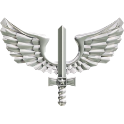
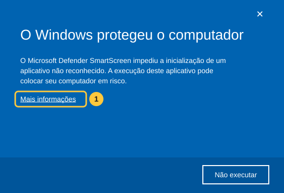
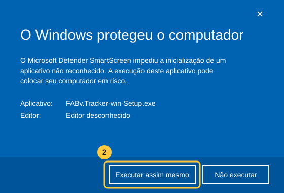

# FABv Tracker

**ACARS da FAB Virtual (FABv)**: rastreia o voo no simulador, mostra a aeronave no mapa e envia o PIREP direto para o site da FABv.

 

  

O botão baixa sempre a versão mais recente · <a href="https://github.com/Thiago-Bilangieri/FABvTracker-releases/releases">todas as versões e novidades</a>

---

## Requisitos

- Windows 10 ou 11 (64 bits)
- MSFS 2020/2024 **ou** X-Plane 11/12 (o Tracker detecta sozinho qual você abriu)
- Conta na FABv e uma missão reservada no site

Não é preciso instalar mais nada: o .NET já vem junto. O mapa usa o Microsoft Edge WebView2, que já vem no Windows 11 e no Windows 10 atualizado.

## Instalação passo a passo

### 1. Baixe o instalador

Clique no botão **BAIXAR O FABv TRACKER** acima. O arquivo se chama `FABv.Tracker-win-Setup.exe`.

> **O navegador avisou que o arquivo "não é baixado com frequência"?** É normal para aplicativos novos.
> No **Edge**: passe o mouse sobre o download → **⋯** → **Manter** → **Mostrar mais** → **Manter assim mesmo**.
> No **Chrome**: clique em **Manter** (ou **Baixar arquivo suspeito → Baixar assim mesmo**).

### 2. Abra o instalador e libere no SmartScreen

Na primeira vez, o Windows mostra uma tela azul dizendo **"O Windows protegeu o computador"**. Isso acontece porque o FABv Tracker ainda não tem assinatura digital paga e o Windows não o conhece. **Não é vírus.**

**Clique em "Mais informações":**

**Depois clique em "Executar assim mesmo":**

Ilustrações. A tela no seu Windows pode variar um pouco de cor ou de layout.

### 3. Pronto

A instalação é automática, leva alguns segundos e **não pede senha de administrador**. O FABv Tracker abre sozinho no fim e cria um atalho na **área de trabalho** e no **menu Iniciar**.

O aviso do SmartScreen só aparece nessa primeira instalação: as atualizações não passam por ele.

## Atualizações automáticas

Você não precisa baixar de novo. Sempre que o FABv Tracker abre, ele verifica se há uma versão nova e, se houver, **baixa e reinicia já atualizado** antes do login. A janela mostra o progresso, normalmente em poucos segundos.

Sem internet, ele abre normalmente na versão que você já tem.

As novidades de cada versão ficam na [página de versões](https://github.com/Thiago-Bilangieri/FABvTracker-releases/releases).

## Como voar

1. **Reserve a missão** no site da FABv.
2. **Abra o simulador** e posicione a aeronave no solo, no aeroporto de origem da missão.
3. **Abra o FABv Tracker** e faça login com o ID do piloto (ou e-mail) e a senha da FABv.
4. Com o simulador conectado e a aeronave na origem (até 3 NM), clique em **Iniciar voo**.
5. Voe normalmente. Fases, eventos e o toque aparecem no log.
6. No destino (até 3 NM), estacione com o freio de estacionamento. O voo é finalizado.
7. Clique em **Enviar PIREP**.

## Desinstalar

**Configurações do Windows → Aplicativos → Aplicativos instalados → FABv Tracker → Desinstalar.**
Seu login salvo e as configurações ficam guardados caso você instale de novo.

## Problemas?

- **O Tracker não conecta ao simulador**: carregue um voo (no menu principal o simulador ainda não está "em voo"). No X-Plane, a comunicação usa a porta UDP 49000, que é a padrão.
- **O mapa não aparece**: instale o [Microsoft Edge WebView2 Runtime](https://developer.microsoft.com/microsoft-edge/webview2/).
- Outros problemas: fale com a equipe da FABv e, se possível, envie o arquivo de diagnóstico do dia, que fica em `%LocalAppData%\FABvTracker\logs\` (cole esse endereço na barra do Explorador de Arquivos).
